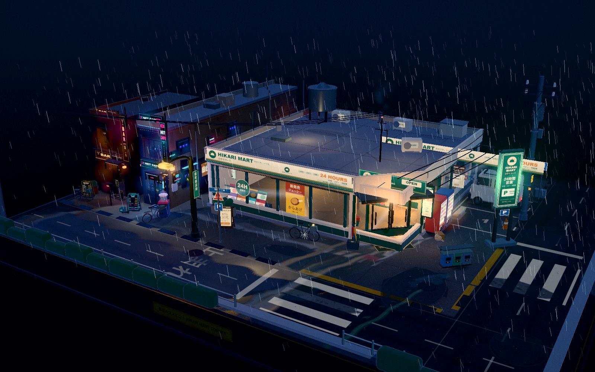

# 雨夜便利店 · Rainy Night Konbini

**在线体验：** [打开 GitHub Pages 雨夜街区](https://kaorumiyagawa.github.io/Rainy-Night-Konbini/)

一个以日式雨夜街区为主题的交互式 Three.js 微缩场景。画面从街角便利店展开，延伸到网吧、酒吧与湿润的夜间街道；霓虹招牌、雨丝和路面反光共同构成安静的城市夜景。

## 场景内容

- 便利店街角与明亮的玻璃橱窗
- 网吧、酒吧及相邻建筑立面
- 街道、停车区域、斑马线、护栏、路灯和架空电线
- 动态雨滴、积水与夜间灯光
- 可旋转、缩放和平移的第三人称观察视角

场景模型与效果整合在根目录的单文件 HTML 中；目前没有独立的模型或贴图目录。项目保留现有实现与美术表现，暂不要求使用构建工具或安装依赖。

## 操作方式

| 操作 | 效果 |
| --- | --- |
| 鼠标左键拖拽 | 旋转视角 |
| 鼠标滚轮 | 缩放视角 |
| 鼠标右键拖拽 | 平移视角 |

触屏设备可尝试单指旋转、双指缩放与平移；桌面浏览器体验更完整。

## 运行

在线版本通过 GitHub Pages 发布，可直接在浏览器体验；本地仍可在文件管理器中用 Chrome 或 Edge 打开 [`index.html`](index.html)。场景使用内嵌 Three.js，不需要安装插件或构建工具。在线页面通过 HTTPS 提供，后续推送到 `main` 分支的提交会自动更新站点。

## 技术与协作

- **Three.js r180**：负责 WebGL 三维场景、材质、灯光与动画。
- **OrbitControls**：实现相机的旋转、缩放和平移。
- **Canvas / WebGL**：单页内嵌实现，未使用外部模型、贴图加载流程或打包工具。
- **AI 协作背景**：项目最初由 DeepSeek 辅助生成，之后经过功能迭代与场景扩展。本仓库如实保留这段协作背景，不将 AI 生成或协助的代码描述为完全手写。

## 开发记录

- [CHANGELOG](CHANGELOG.md)：当前开发快照与版本变化
- [开发日志](docs/DEVELOPMENT_LOG.md)：从便利店主题到街区场景的现存证据记录
- [路线图](docs/ROADMAP.md)：后续模型、街区、光影与性能计划
- [第三方声明](THIRD-PARTY.md)：内嵌 Three.js、许可证及资源来源说明

当前基线版本为 **0.3.0-dev**，表示仍在持续开发的街区场景快照，不代表正式发行版。
